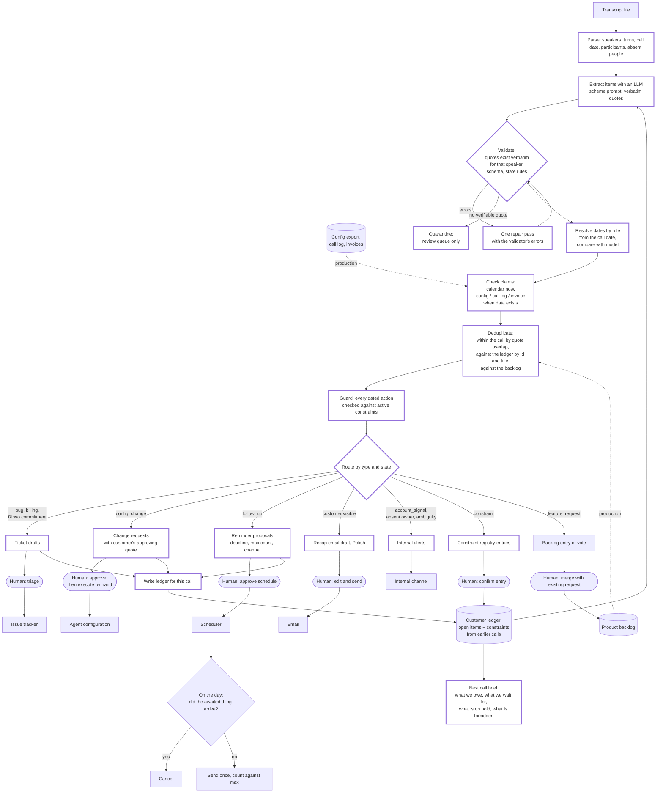

# Process: from call transcript to actions

Thick borders mark what this repository builds. Dotted inputs (backlog, configuration export, call log) are wired in the design but not in the slice, because no such data was provided with this call. Everything to the right of a human step is outside the slice: the system writes drafts, never sends or changes anything.

## Where humans approve

| Step | Who | What they check |
|---|---|---|
| Change request | Account manager, then whoever executes | The customer's quote really approves this exact value; conditions hold; no active constraint blocks it |
| Recap email | Account manager | Every line was agreed; nothing internal leaks; tone |
| Reminder schedule | Account manager | Count and channel match what the customer asked for; the pre-send check is clear |
| Credit or invoice correction | Finance | The error is ours; amount |
| New constraint | Account manager | Wording and validity window, since it binds every later action |
| Quarantined item | Account manager | Whether the model invented it or misquoted a real item |

## Deduplication

- **Within the call.** A closing summary repeats earlier agreements. The prompt treats repeats as confirmation evidence, and the validator flags two items of the same type whose quotes overlap by half or more.
- **Against the previous call.** The previous ledger goes into the prompt with item ids. The model links an item with `previous_id`; the code checks that the id exists and, when no link is given, flags items whose titles resemble a previous item of the same type. Linked items replace the earlier version in the new ledger.
- **Against the backlog.** In production, feature requests are matched against the backlog before filing, so a known request gets a vote and the customer's success measure instead of a new ticket. The slice marks requests the call itself calls known ("other customers asked") as `known_other_customers`.

## Carry-over to the next call

`ledger.json` is written for every call under `out/<customer>/<date>/`. On the next run for the same customer the newest earlier ledger is loaded automatically:

1. Open, conditional, pending, deferred and blocked items are passed to the model as context and carried into the new ledger unless the new call updates or closes them.
2. Active constraints are carried until their window ends (a holiday freeze ending on 23 October is dropped from a call on 26 October) or until the named approver lifts them in a later call.
3. `next_call_brief.md` lists what Rinvo owes, what the customer owes, what is waiting for whom, and every constraint in force, so the account manager opens the next call with the state rather than with the last recap.
