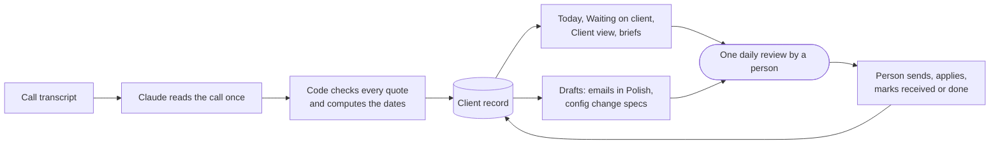
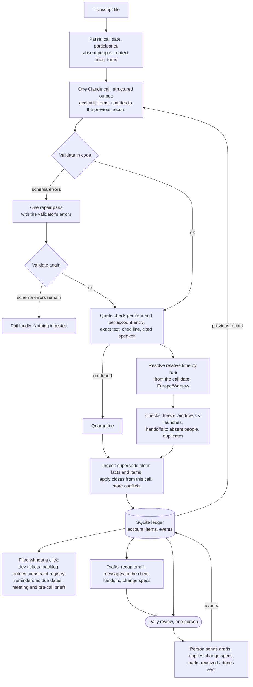

# Process: from call transcript to the client record

## In short

The system prepares; a person decides. Nothing reaches the client, the client's configuration or money without that review.

## In detail

## Legend

| | What | Where it appears |
|---|---|---|
| Runs automatically | Extraction, quote checks, date resolution, the client record (people, who decides what, current facts), dev tickets, backlog entries, constraint registry, reminders as due dates, meeting brief, pre-call brief | `out/<client>/<date>/`, panel: Today, Client, Waiting on client |
| Comes out as a draft | Recap email and messages in Polish, handoffs to colleagues, configuration change specs, credits and invoice corrections | panel: Drafts and Daily review, `out/.../drafts/`, `change_specs.md` |
| One human step | The daily review: send drafts, apply specs, mark received / done / sent | panel: Daily review |
| Never done by the system | Send anything to the client, change the client's configuration, launch campaigns, touch money | |

## What runs on its own

Every transcript produces, without a human step: dev tickets with the reported evidence (`dev_tickets.md`), backlog entries with the client's success metric and a "no deadline promised" flag (`backlog.md`), the constraint registry, reminders, the client view, a brief for every meeting other items point to, and a pre-call brief for the next call.

A reminder is a due date on a `follow_up` item that watches a client commitment. On the due day it appears in the owner's Today view with its Polish draft, but only if the watched commitment has not been marked received and the reminder has been sent fewer times than its `max_count`. There is no scheduler.

## The one human step: the daily review

Anything that would reach the client, change the client's configuration, or move money leaves the system only as a draft. One person opens the daily review (`/review` or `python -m callstate review`) and sees:

| Section | Content |
|---|---|
| Drafts ready to send | Recap email, messages whose item is actionable, reminders due today, handoffs to colleagues |
| Due today, per assignee | Rinvo items due or overdue, conditional items whose date came, client items that are late |
| Quarantined | Items and account entries whose quote is not on the cited line for the cited speaker |
| Ambiguities | Places the call left unclear, with the reading the model chose |
| Constraint conflicts | Launches dated inside a freeze window, conflicts with earlier agreements found in a later call |

Sending a draft, applying a change spec, or noticing that a file arrived is recorded as an event (`sent`, `done`, `received`, `condition_met`). Events drive the next day's view.

## Requests from other people

`/client` has a request check, also `python -m callstate check --sender NAME --text "..."`. The message is matched against holds and constraints by their keywords. If the sender is not among the approvers in the authority matrix for that item, the answer is "cannot approve, confirm with X first" plus the rule from the call. Nothing changes.

## Later calls

The next transcript for the same client is processed against the stored record. The prompt carries the authority matrix, current facts and live items with their ids. The model returns `previous_id` for items that continue, `previous_updates` for items this call closes or changes, and `conflicts` with earlier agreements. Ingest marks older facts with the same key as superseded and links them, sets the new state on updated items, and keeps both versions. Conflicts go to the daily review.
